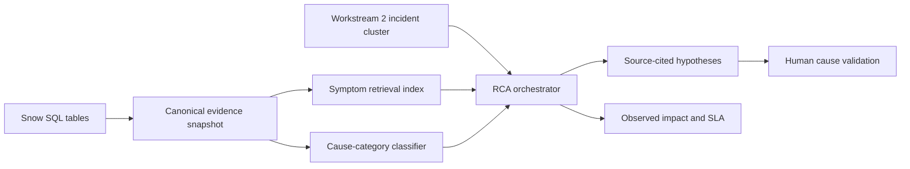

# CoreMind — Workstream 3 RCA

A runnable local RCA model and dashboard backed by the Snow tables in `CorpIT_DnA_Analytics.Service_Analytics`. It implements the Workstream 3 outputs in the reference architecture: root-cause hypotheses, evidence summaries, confidence scores and impact analysis.

This version uses a deterministic evidence orchestrator, TF-IDF symptom retrieval and a supervised cause-category classifier. It does not deploy an Azure AI Foundry agent or call an LLM. The RCA report is a set of hypotheses for human validation, rather than an automatically confirmed root cause.

## Run

Python 3.13 and ODBC Driver 18 for SQL Server are available on this machine. The supplied SQL connection has been configured in the ignored local `.env`; passwords are not embedded in source code or model artifacts.

```powershell
python -m pip install -r requirements.txt
python -m coremind build
python -m coremind serve
```

Open **http://127.0.0.1:8000**. API documentation: **http://127.0.0.1:8000/docs**. The dashboard and API use the saved snapshot; they do not issue SQL writes. The server binds to loopback and has no authentication, so keep it local until authentication is added.

```powershell
python -m coremind investigate --incident INC1211701
python -m coremind investigate --query "database connectivity failures" --company "Your company"
python -m coremind investigate --cluster examples/workstream2_cluster.json
python -m coremind status
python -m pytest -q
```

Replace the incident ID with one from the dashboard or the extracted snapshot. If a requested ID is absent from the bounded extraction, the API reports that explicitly. Run `build` again after changing extraction settings, then restart the dashboard to load the new snapshot.

The first build indexed **61,443 ticket documents** across **92,729 canonical records**, including **367 historical problem-linked incidents**. A real-data check verified that `INC1211701` links to `PRB0001064`, whose recorded cause is `Network`. The saved report is `artifacts/latest_rca.json`; it cites that problem and requires cause validation. All **19 automated tests** pass, and an unknown symptom query correctly abstains.

The dashboard has also been started in the background on this machine. Its process ID is in `artifacts/server.pid`. To stop this specific background server:

```powershell
Stop-Process -Id ([int](Get-Content artifacts/server.pid))
```

Extraction checkpoints are saved after each table. If modeling fails after extraction is complete, use `python -m coremind build --resume` to refit from that checkpoint, then restart the dashboard. Resume requires the same database, schema, cutoff, row limit and timezone settings.

## RCA workflow

1. Normalize table-specific fields, remove HTML, parse verified day-first dates, redact email addresses and labeled secrets, and deduplicate ticket IDs. Affected-user identifiers are hashed; free text can still contain personal information.
2. Retrieve tickets by symptom similarity; cause labels, fixes and resolution notes are excluded from feature construction.
3. Inspect exact problem-to-incident and problem-task relationships, and retrieve similar historical problems within the selected company.
4. Correlate preceding changes within 72 hours. Require a shared CI or both service and assignment group. Actual work start and planned start are distinguished, and canceled changes are excluded.
5. Generate source-cited hypotheses. Rank evidence strength using a transparent heuristic. The cause classifier supplies separate investigative leads and does not count as evidence.
6. Measure observed incident, priority, recorded-user, service, CI, location, assignment-group and SLA impact. Related seed investigations use a seven-day window and matching CI/service. Counts describe the extracted snapshot.
7. Abstain when causal evidence is insufficient, and return missing evidence and validation steps. No remediation or Snow record creation is performed.

Workstream 2 can send `incident_ids`, `summary` and `company` using the example JSON contract. API equivalent: `POST /api/investigate` with `query`, `incident_ids`, `company` and optional `top_k`.

## Tables and known constraints

| Snow table | RCA role |
|---|---|
| snow_Incident_DnA | Symptoms, recurrence, resource context and observed impact |
| snow_Problem_DnA | Recorded cause codes and explicit first-incident relationships |
| snow_Problem_Task_DnA | Linked task causes and close notes, when available |
| snow_Change_DnA | Preceding change correlations |
| snow_case_DnA | Similar customer case symptoms |
| snow_RequestedItems_DnA | Supporting request context |
| snow_ServiceCatalog_Task_DnA | Supporting catalog-task context, when available |
| snow_SLA_Incident_DnA | Observed incident SLA breaches |
| snow_SLA_RITMS_DnA | Request SLA snapshot, retained for future request investigations |
| snow_AssignmentGroup_DnA | Responsible-group capability and responsibility context |

Source profiling found approximately 1.3 million incidents, 1,090 problems and 328 nonblank problem cause labels. Problem-task and catalog-task tables were empty. Some cause labels are generic, and not every labeled problem is closed or eligible for training.

The `fix` field in the problem table is a timestamp and `knowledge` is a flag; they are not resolution text or knowledge-article content. Incident `resolution_code` is a category rather than resolution notes. There are no standalone KB articles, work notes, logs, ITOM events or CMDB dependency relationships in these tables.

Extraction defaults to the latest **15,000 rows per table**, plus historical incidents explicitly referenced by the problem records. Per-table truncation, linked-incident coverage and date-parse failures are reported in `artifacts/manifest.json`. This is a bounded prototype, not a complete fleet-wide index. SLA extraction is bounded independently, so a missing SLA row does not imply compliance. Outage hours are summed ticket intervals rather than deduplicated service downtime.

Dates use verified day-month-year strings and ISO timestamps. Naive values are assumed to use `Asia/Dubai`; set `RCA_SOURCE_TIMEZONE` to the actual source timezone if different. The extract cutoff is explicit in `RCA_AS_OF` and defaults to the end of 8 October 2026 in Dubai. Created-after-cutoff records are excluded. Unknown dates are retained and reported. This cutoff is not a historical database snapshot: mutable descriptions, labels, SLA status and updates can still reflect later information.

## Model and evaluation

TF-IDF unigram/bigram features use titles, descriptions and service/resource context. Cosine similarity retrieves symptom analogies. Logistic regression predicts the recorded broad `cause_code` for closed, labeled problem records. Classes require at least three records, and generic `Other`/unknown labels are excluded. Exact duplicate feature texts are deduplicated.

Validation uses a chronological 80/20 split. Training labels must have closed before the holdout boundary. Test duplicates of training feature text are removed. Outputs include top-1 accuracy, top-3 accuracy, macro F1, the majority-class baseline and a confusion matrix in `artifacts/evaluation.json`. The final classifier is then fitted on all eligible labels, independently of the reported holdout model.

Current source descriptions may already contain diagnosed causes; there are no incident-time text versions or label timestamps. Consequently, evaluation is retrospective and may overestimate live predictive quality. Confidence scores and classifier probabilities are uncalibrated. Service SMEs must validate the root-cause mechanism.

The initial validation used 294 eligible closed problem labels, with 170 temporally eligible training records and 59 holdout records. Results were **25.4% top-1 accuracy**, **62.7% top-3 accuracy**, **0.114 macro F1**, and **16.9% majority-class baseline accuracy**. This is an exploratory cause-category model, suitable for leads rather than autonomous RCA. Current artifact metadata is the authoritative result after a rebuild.

Artifacts are local and ignored by Git:

- `artifacts/model.joblib`: retrieval index, classifier, canonical records and metadata. Load only the locally generated file; joblib can execute code when loading untrusted files.
- `artifacts/manifest.json`: coverage, date parsing, label distribution, versions and limitations.
- `artifacts/evaluation.json`: holdout validation results.
- `artifacts/latest_rca.json`: a generated investigation report.

## Azure AI Foundry path

The local orchestration stages map to read-only tools for retrieval, problem lookup, change correlation and impact assessment. For the Azure architecture, first publish the canonical evidence to the Workstream 1 curated layer and use the Workstream 2 cluster contract as the trigger. A Foundry agent can then call those tools and draft a structured RCA response. Validate that every citation exists, retain deterministic impact calculations, require abstention for missing evidence, and keep human approval for root-cause confirmation and remediation.



An Azure project endpoint, model deployment, identity, permissions and hosting configuration are needed before that integration can be implemented and tested. No Azure resources were provisioned by this build.

## RCA workspace UI

The dashboard includes five views, served directly by FastAPI without a frontend build step:

- **Overview:** real snapshot KPIs, a 14-day incident creation chart, priority distribution, top services, recent incidents and incident-to-problem examples.
- **Investigations:** scoped incident/symptom input, Workstream 2 cluster JSON import, hypothesis cards and comparison, evidence search and source-record drawer, observed impact, record timeline, review checklist and session history.
- **Incident explorer:** search, company/state/priority filters, pagination and selection of up to 100 incidents within one company.
- **Data & model health:** actual holdout metrics, label distribution, source-table coverage, parsing failures, limitations and snapshot provenance.
- **How to read results:** an interactive five-step guide, current-report score explanations, clearly labeled illustrative examples, common mistakes and a glossary. Contextual `?` buttons explain evidence scores, similarity, snapshot scope, SLA counts, record timelines and validation status.

Read a report in this order: **brief → hypotheses → source evidence → observed impact → validation**. A score such as `0.57` indicates heuristic evidence strength, not a 57% chance of a correct cause. Similarity reflects symptom-text overlap. Classifier percentages are uncalibrated broad-category leads. Zero observed SLA breaches does not prove compliance, and timeline dates show record creation. The root cause remains unconfirmed until the responsible team validates a specific failure mechanism.

Reports export as JSON or a printable investigation brief. History and review checkboxes are held in browser memory for the current page session; they are not persisted or written to Snow, and completing checks does not confirm the root cause. Charts and operational counts describe the bounded snapshot, rather than full ServiceNow volumes. The timeline shows record creation dates, not inferred outage or execution times.

Markup, styles and interactions live in `web/index.html`, `web/styles.css` and `web/app.js`. Icons and charts are local SVGs; there are no external frontend fonts, CDN scripts or asset requests. Mobile navigation, keyboard-accessible tabs, focus outlines, a native evidence dialog, loading/error/empty states and reduced-motion styling are included.

```powershell
python -m pytest -q
npm ci --ignore-scripts
npm run test:ui
npm run test:ui:live  # optional: requires the local server on port 8000
```

Node.js and jsdom are development-only dependencies for UI checks. The running application needs only the Python requirements. UI tests exercise DOM interactions and mocked API responses; they do not replace a browser visual review. A live API check also validates the new components against the actual saved Snow model.

UI test reference: [jsdom script execution](https://github.com/jsdom/jsdom#executing-scripts).

References: [scikit-learn TF-IDF](https://scikit-learn.org/stable/modules/generated/sklearn.feature_extraction.text.TfidfVectorizer.html), [Microsoft Foundry retrieval and grounding](https://learn.microsoft.com/en-us/azure/foundry/concepts/retrieval-augmented-generation?view=foundry-classic).


## RCA effectiveness and recurrence trends

Open **RCA effectiveness** in the top navigation. This page is separate from
investigation drafting: it measures observed incident recurrence after problem closure.
It includes 7-, 14-, 30-, and 90-day comparison windows, company and problem filters,
an outcome register, a per-problem trend, and source incident drilldown.

The comparison point is the problem's recorded closure date, for a Closed/Resolved
problem with consistent timestamps. The source does not include verified RCA approval
or corrective-action completion. Closure is therefore a timing proxy, not confirmation
that an RCA was correct or that a fix caused improvement.

Incident families use explicit first-reported incident links, plus similar symptom text
(cosine threshold 0.35) within the same company and CI, or the same company, service,
and assignment group. If a linked incident exists, it supplies the symptom anchor;
otherwise the problem description is used. Candidate matches need analyst validation.
An incident can match more than one problem; the summary recurrence total deduplicates
incident IDs while per-problem counts retain those relationships.

The score is `clamp(100 * (1 - after_count / before_count), 0, 100)` for equal windows.
The actual reduction percentage remains visible even when negative. Scoring requires
at least three baseline incidents, coverage of both windows, and a completed follow-up
window. Missing history, a small baseline, ongoing monitoring, and problems awaiting
closure remain unscored. Hatched chart intervals indicate unobserved or incomplete days.
A score of 100 means no matching recurrence was observed in the selected window;
it does not establish causal prevention or guarantee future non-recurrence.

For the current bounded latest-N extraction, continuous history starts at the oldest
incident in the primary extract. Older incidents appended solely through explicit problem
links do not extend that coverage. Unknown coverage, ambiguous extraction losses,
or incident creation-date parse failures withhold scores. A latest-row-only snapshot may have no fully scorable problems; the screen exposes
candidate recurrences and evidence gaps. The Snow SQL backfill below supplies targeted history.
Load a rebuilt snapshot with enough baseline and follow-up history, then restart the
service to refresh the analysis. Refreshing the page alone does not fetch new SQL data.

Read-only endpoints: `GET /api/effectiveness?window_days=7&company=...` and
`GET /api/effectiveness/{problem_id}?window_days=7`. Per-problem evidence is capped at
100 displayed records, while counts and trends use all matches. Calculations are cached
only for the loaded snapshot. There are no SQL writes, autonomous remediation, scheduled
refreshes, or claims of guaranteed prevention.

Run `python -m pytest -q`, `npm run test:ui`, and `npm run test:ui:live` for validation.
The live check defaults to port 8011; set `RCA_BASE_URL` to override it.


The effectiveness page also groups unscored problems by the reason blocking their
score. Selecting a reason filters the outcome register. Each problem displays a
five-item evidence checklist (closure, baseline history, follow-up history, elapsed
follow-up time, and baseline size). An unknown baseline size remains unknown when
history is missing. This checklist measures data readiness, not RCA effectiveness.


### Snow SQL history backfill

Set the Snow SQL connection fields in the ignored `PPDModel/.env` (see `.env.example`).
Do not paste passwords in chat or commit them. The configured database, schema and cutoff
must match the model snapshot. The backfill uses only parameterized SELECT queries.

```powershell
python -m coremind backfill-history --plan
python -m coremind backfill-history --window-days 90
# If interrupted, resume the identical source and snapshot:
python -m coremind backfill-history --window-days 90 --resume
```

This selects all incident rows matching each eligible closed problem's company and
resource context in its comparison period. It does not use the latest-N limit.
Rows stream in batches, and a checkpoint is saved after each query batch. Dates that
cannot be parsed and missing incident IDs invalidate coverage for that batch rather
than awarding a score. Problems without usable context cannot be backfilled this way.

A new model is fitted in a staging folder while the running service keeps the prior
snapshot. Existing model files are backed up under `artifacts/before-history-backfill/`;
the model bundle is replaced only after fitting succeeds. Restart the RCA service to
load it. Per-problem coverage is stored in the model and accepted only while the closure
date and matching contexts still agree. The UI continues to show the main latest-N
extract interval; targeted history applies only to the problems it fully covers.

Backfilling improves data coverage; it does not make every problem scoreable. A genuine
small baseline, incomplete follow-up, missing closure, or invalid context still withholds
the outcome score. Rebuilding for a later cutoff requires source data for that cutoff;
this command deliberately keeps the loaded model's cutoff unchanged.

The effectiveness screen opens with a 90-day comparison and prioritizes scored outcomes
when available. Use All problems or the reason filters to inspect unscored cases.
